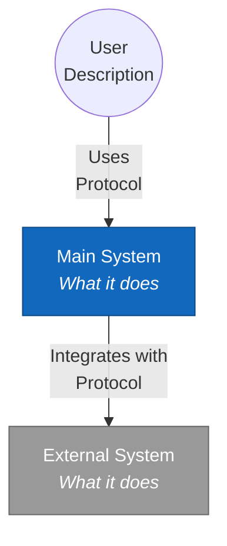
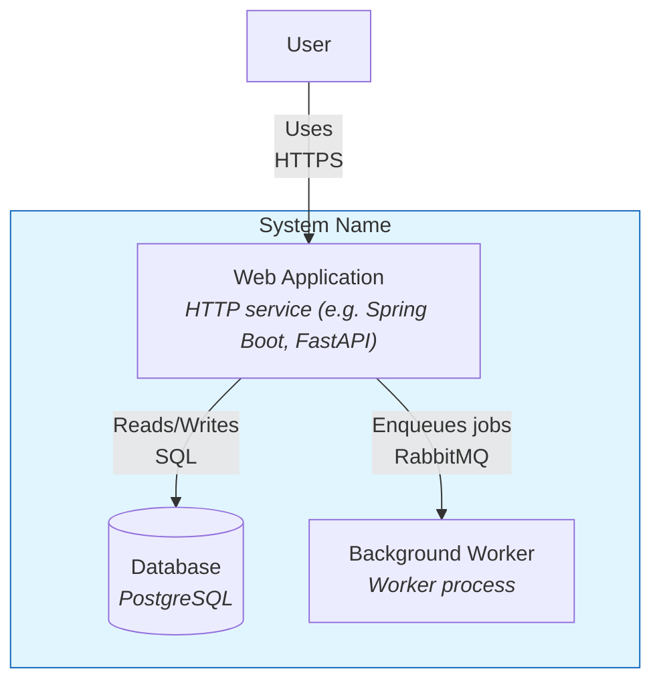
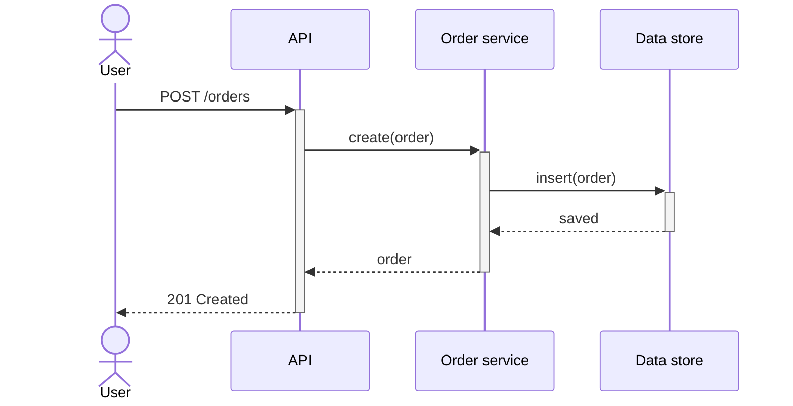
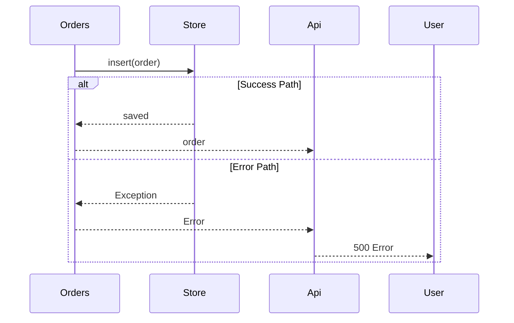

# UML Diagram Skill (Mermaid)

Create and maintain Mermaid diagrams to visualize system architecture, components, and interactions. Mermaid diagrams render natively on GitHub, GitLab, Azure DevOps and many documentation platforms; no external tool is needed.

## Why Mermaid?

- **Native rendering** on GitHub, GitLab and Azure DevOps; **no build step** and no generated images to commit.
- **Plain markdown text**: edit it in the web UI, review it in a diff, preview it in most IDEs.
- **vs PlantUML**: more features, but it needs a Java runtime, an external tool to generate images, committed images and regeneration on every change. Mermaid is better for GitHub-based projects.

## When to Use

Apply this skill when documenting new system architecture, explaining component relationships, visualizing sequence flows, creating technical documentation, onboarding new team members, reviewing system design, or planning architecture changes.

## Reference map

Load only the file you need. Section numbers match the original skill.

| Section | Topic | Load when | File |
| --- | --- | --- | --- |
| 2b | Async-processing and loop sequence patterns | the flow has a queue, a worker or iteration | [`references/diagram-types.md`](./references/diagram-types.md) |
| 3-7 | Class, state, ERD, flowchart and Gantt templates | the diagram is not a context, container or sequence diagram | [`references/diagram-types.md`](./references/diagram-types.md) |
| Patterns | Strategy, event-driven and repository diagrams | visualising one of those patterns | [`references/patterns-and-styling.md`](./references/patterns-and-styling.md) |
| Styling | Themes, node styling | the diagram needs colour or a theme | [`references/patterns-and-styling.md`](./references/patterns-and-styling.md) |
| Integration | Linking diagrams from README, ADRs and context docs | placing a diagram in a document | [`references/patterns-and-styling.md`](./references/patterns-and-styling.md) |
| Setup | Where Mermaid renders, IDE preview, CLI, online editors | the developer asks how to preview or export | [`references/setup-and-tooling.md`](./references/setup-and-tooling.md) |
| Validation | Syntax check, CI step, troubleshooting, resources | a diagram does not render or CI must validate | [`references/setup-and-tooling.md`](./references/setup-and-tooling.md) |

## Diagram Types

### 1. System Context / Architecture Diagrams

#### System Context Diagram
**Purpose**: Show the system in its environment with external dependencies

**Template**:
````markdown

````

**When to Create**: At project start, or when external dependencies change

**Where it lives**: one copy only — `context/system-context.md` when the repo has a `context/` folder, otherwise
`docs/diagrams/c4-context.md` (`documentation-and-adr` §3). For `context/system-context.md` there is a blank template in [`context-maintenance`](../context-maintenance/templates/context/system-context.md): paste the diagram above and fill it in.

#### Component/Container Diagram
**Purpose**: Show high-level technology choices and component interactions

**Template**:
````markdown

````

**Where it lives**: `context/component-diagram.md`, or `docs/diagrams/c4-component.md` without a `context/` folder (blank template in [`context-maintenance`](../context-maintenance/templates/context/component-diagram.md))

### 2. Sequence Diagrams

**Purpose**: Show interactions over time between components

**Template** (generic names; use the project's own component names, whatever its layering):
````markdown

````

**Common Patterns**:

**Error Handling**:
````markdown

````

Async processing and loops: [`references/diagram-types.md`](./references/diagram-types.md) §2b.

**Where it lives**: `context/domain-flow.md` (blank template in [`context-maintenance`](../context-maintenance/templates/context/domain-flow.md))

### 3-7. Class, state, ERD, flowchart and Gantt diagrams

Templates live in [`references/diagram-types.md`](./references/diagram-types.md). Pick the type by purpose:

| Type | Use for |
| --- | --- |
| Class | class structure and relationships (types follow the project's language) |
| State | lifecycle transitions of one entity |
| ERD | database schema |
| Flowchart | process flows and decision trees |
| Gantt | project timelines |

## Best Practices

### 1. Keep Diagrams Simple
- One concept per diagram
- Max 7-10 components per diagram
- Split complex systems into multiple diagrams

### 2. Use Consistent Naming
- Match code class/component names
- Use descriptive names
- Follow naming conventions from code

### 3. Layer Your Diagrams
- **Level 1**: System Context (external view)
- **Level 2**: Container (high-level tech)
- **Level 3**: Component (detailed structure)
- **Level 4**: Code (class diagrams)

### 4. Keep Updated
- Update diagrams when code changes
- Review diagrams during code reviews
- Include diagram updates in PR checklist

### 5. Version Control
- Store `.md` files in git (native rendering)
- No need to commit generated images (reduces repo size/noise)
- Keep diagrams close to code they document

## Documentation Integration

Link diagrams from the README and ADRs by path; in context documentation wrap the Mermaid code in a fenced code block with the `mermaid` language identifier. Examples: [`references/patterns-and-styling.md`](./references/patterns-and-styling.md).

## Validation

Check the syntax in an IDE preview or https://mermaid.live/. A CI step can render every `context/*.md` block with the pinned Mermaid CLI; the step and the troubleshooting list (GitHub not rendering, size limits, arrow syntax) are in [`references/setup-and-tooling.md`](./references/setup-and-tooling.md).

## Examples

The `context/` templates shipped by `context-maintenance` are blank scaffolds; the worked examples are the templates in
this skill.

### Example 1: Main Domain Flow
Sequence template (§2), saved in `context/domain-flow.md` ([blank template](../context-maintenance/templates/context/domain-flow.md)).

### Example 2: System Context
System Context template (§1), saved in `context/system-context.md` ([blank template](../context-maintenance/templates/context/system-context.md)).

### Example 3: Component Structure
Component/Container template (§1), saved in `context/component-diagram.md` ([blank template](../context-maintenance/templates/context/component-diagram.md)).

## Related Skills

- [context-maintenance](../context-maintenance/SKILL.md) - Maintain context docs
- [documentation-and-adr](../documentation-and-adr/SKILL.md) - General documentation
- `api-design` (Java) - API design documentation
