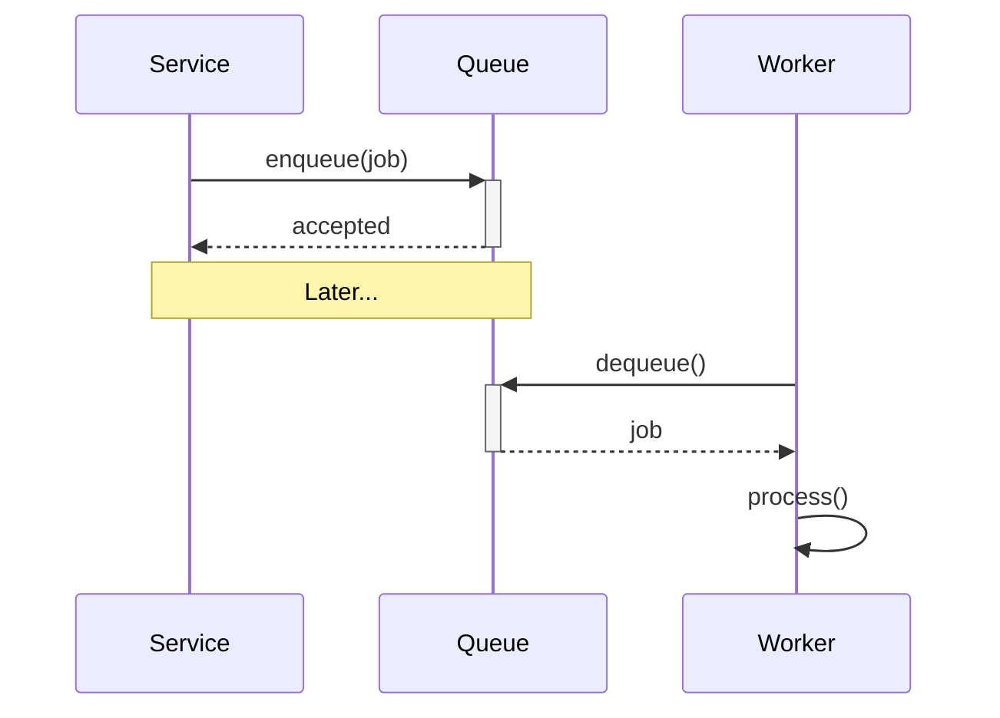
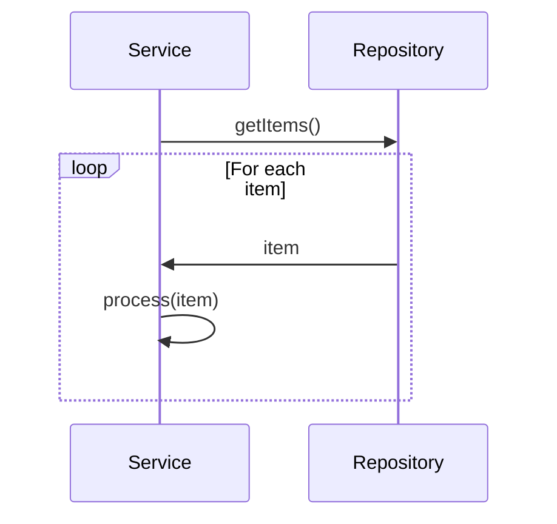
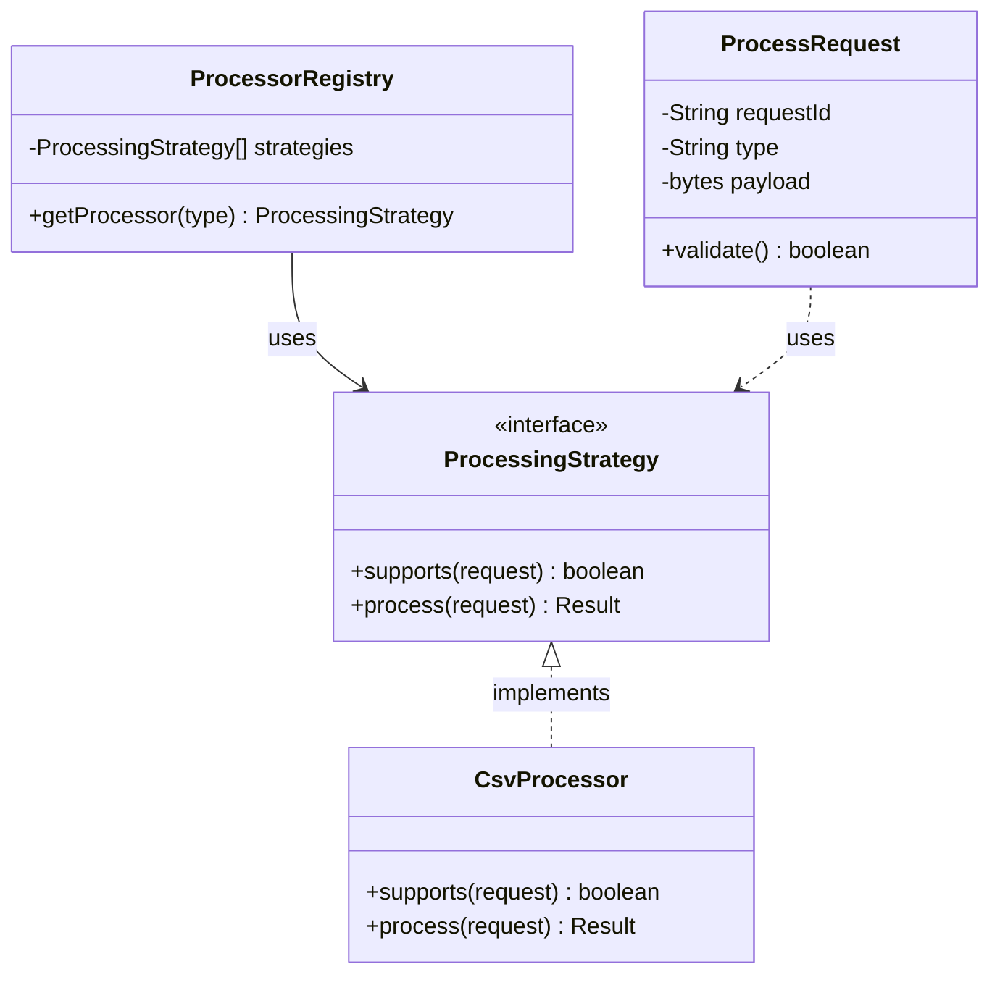
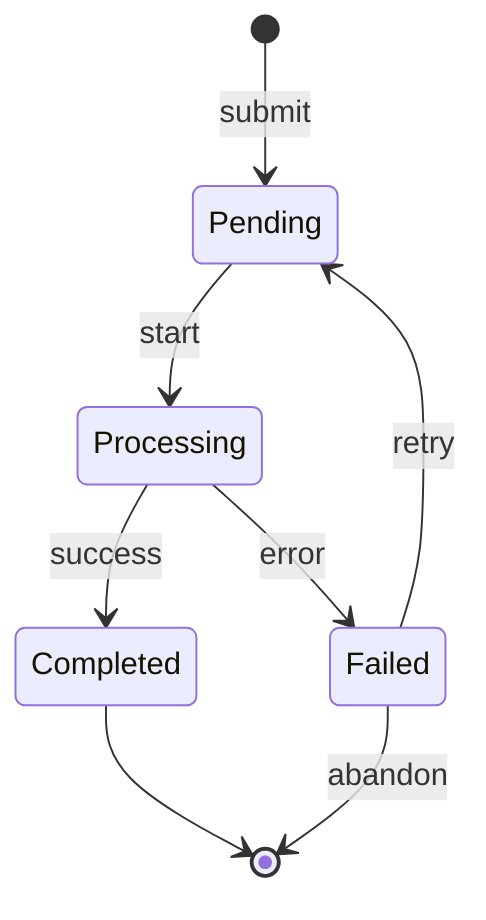
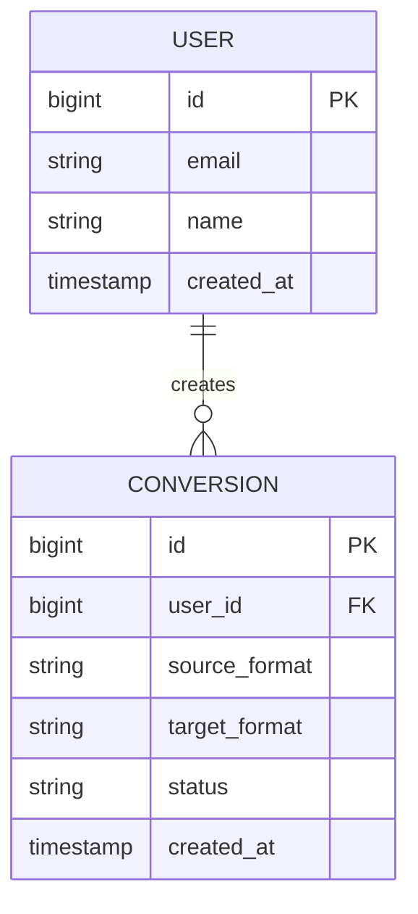
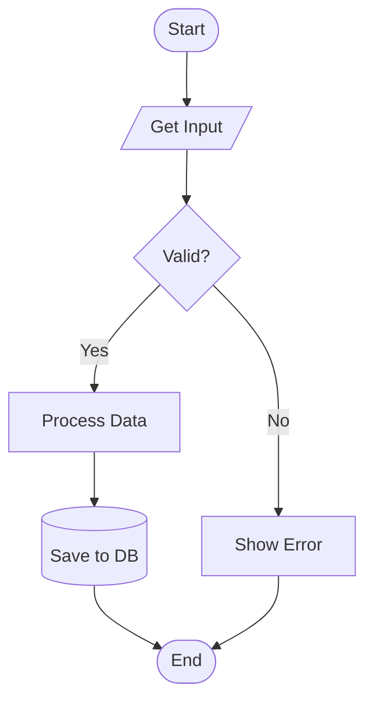
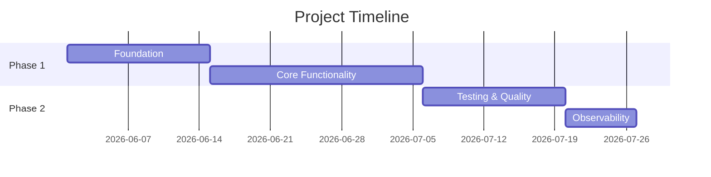

# UML Diagram — more diagram types

Loaded from [`uml-diagram`](../SKILL.md); section numbers match the originals.

## 2b. Sequence patterns: async processing and loops

**Async Processing**:
````markdown

````

**Loops**:
````markdown

````

## 3. Class Diagrams

**Purpose**: Show class structure and relationships

**Template**:
````markdown

````

Type names follow the project's language: `String` / `str` / `string`, and a collection as `List~T~` (Java), `list~T~` (Python) or `T[]` (TypeScript).

**Relationship Types**:
- `<|--` : Inheritance
- `*--` : Composition
- `o--` : Aggregation
- `-->` : Association
- `..|>` : Realization/Implementation
- `..>` : Dependency

## 4. State Diagrams

**Purpose**: Show state transitions

**Template**:
````markdown

````

## 5. Entity Relationship Diagrams (ERD)

**Purpose**: Database schema visualization

**Template**:
````markdown

````

## 6. Flowcharts

**Purpose**: Process flows and decision trees

**Template**:
````markdown

````

## 7. Gantt Charts

**Purpose**: Project timelines and schedules

**Template**:
````markdown

````
