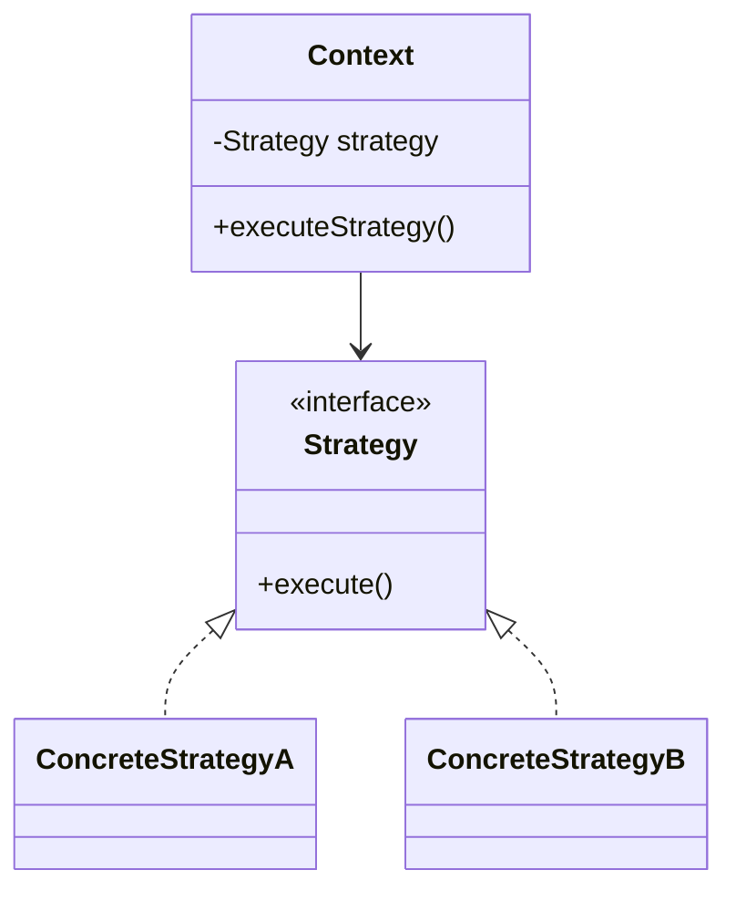
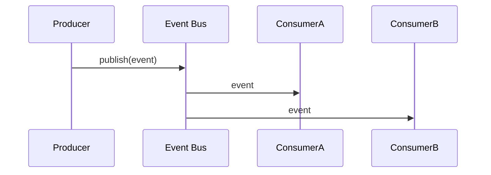
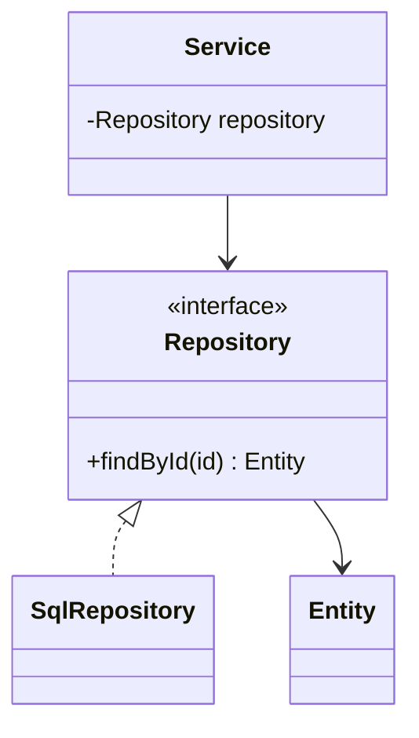
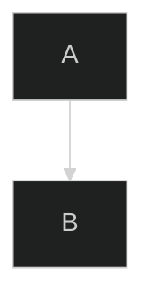
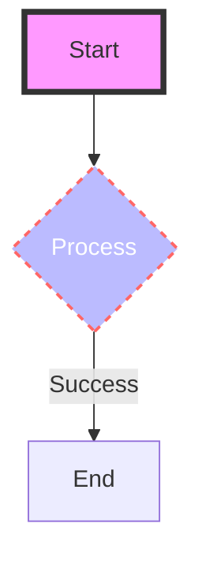
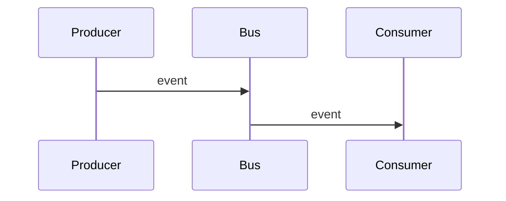

# UML Diagram — patterns, styling and documentation integration

Loaded from [`uml-diagram`](../SKILL.md).

## Common Patterns

### Strategy Pattern Visualization

````markdown

````

### Event-Driven Architecture

````markdown

````

### Repository Pattern

````markdown

````

## Styling and Theming

Mermaid supports styling individual nodes and overall themes.

### Themes
You can set themes at the top of the mermaid block:
````markdown

````
Available themes: `default`, `forest`, `dark`, `neutral`, `base`.

### Custom Node Styling
````markdown

````

## Documentation Integration

### In README.md

````markdown
## Architecture

See our architecture diagrams:

- [System Context](context/system-context.md)
- [Component Diagram](context/component-diagram.md)

Diagrams are rendered natively in the browser on GitHub.
````

### In ADRs

````markdown
# ADR-0001 — Use Event-Driven Architecture

## Decision
We will use event-driven architecture.

## Interaction Flow

````

### In Context Documentation

Simply wrap the Mermaid code in a fenced code block with the `mermaid` language identifier.
